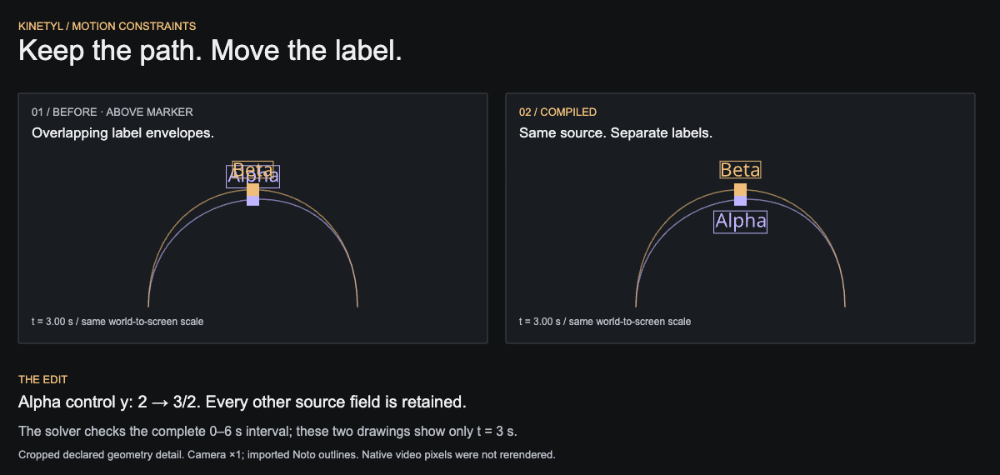
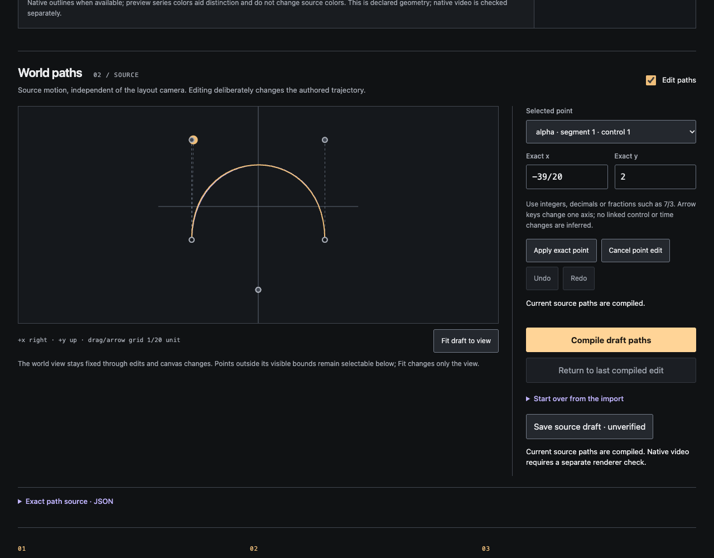

# Kinetyl

**Compile moving diagrams that keep their meaning.**

Labels collide between keyframes. Portrait crops erase important points. Kinetyl solves label placement and camera framing across the entire supported straight or cubic motion, while keeping your world paths, event times and projected label sizes fixed.

[Open the studio](https://nazeeh111.github.io/Kinetyl/) · [Download](https://github.com/nazeeh111/Kinetyl/releases) · [Scene format](SCHEMAS.md)

<picture>
  <source media="(max-width: 600px)" srcset="docs/presentation/motion-mobile.png">
  
</picture>

**Edit the motion deliberately. Compile the presentation without moving it again.** In an actual studio journey, Alpha's first control y changed from `2` to `3/2`. Undo and Redo retained the exact source. Compilation then separated the labels; changing to 9:16 retained the edited paths, timing and measured geometry. The exported plan reopened in a fresh browser.

The drawing shows one moment, not the proof. The verifier checks the full supported 0–6 s interval using rational geometry. [Reopen the portable studio](docs/presentation/edited-studio.zip) · [Inspect the exact edit and limits](docs/presentation/README.md) · [Wide plan](docs/presentation/edited-wide.plan.json) · [Portrait plan](docs/presentation/edited-portrait.plan.json).

[Current studio capture](docs/images/studio-current.png) and its [provenance](docs/images/current-capture.json) remain separate. Earlier actual native exports: [wide](docs/native/curved-wide.mp4) and [portrait](docs/native/curved-portrait.mp4). This new journey did not rerender native video. [Curved-motion guide](docs/curved-motion.md) · [Earlier walkthrough and scope](docs/launch-film.md).

## Use it

Python 3.11+. The compiler, verifier and exported browser studio need no runtime dependencies or paid service.

### Run the studio from source, without installing packages

```sh
git clone https://github.com/nazeeh111/Kinetyl.git
cd Kinetyl
PYTHONPATH=src python3 -m kinetyl export examples/curved-crossing.plan.json --out my-studio
python3 -m http.server 8000 --bind 127.0.0.1 --directory my-studio
```

Open `http://127.0.0.1:8000`. Export independently verifies the bundled plan before
writing the studio. Compare **Before / Compiled** at **3.00 s**, then switch to
**9:16**. No renderer, graphics adapter or package download is needed for this
route after obtaining the source. The server serves only `my-studio` on your
computer; stop it with Ctrl+C. Choose a new output name if `my-studio` exists.

### Install the CLI for your own scenes

The current source is **0.3.2.dev0**, including project compose/check-build and the portrait comparison fix. Install it in an isolated environment:

```sh
python3 -m venv .venv
. .venv/bin/activate
python -m pip install .
```

The tagged `v0.3.1` wheel and studio ZIP retain their original UI and command set. The `v0.3.0` artifacts are also frozen. [Earlier releases](https://github.com/nazeeh111/Kinetyl/releases) remain available separately.

```sh
kinetyl example curved-crossing --out demo-inputs
kinetyl compile demo-inputs/curved-crossing.scene.json --out compiled
kinetyl verify compiled/plan.json
kinetyl export compiled/plan.json --out studio
python -m http.server 8000 --bind 127.0.0.1 --directory studio
```

Open `http://127.0.0.1:8000`. Each output command requires a new destination and writes a manifest of file hashes. The export includes an editable plan, measured scene and portable ZIP. Imports are data; no imported code executes. `kinetyl example three-streams --portrait --out streams` provides a second editable case.

For your own text and an actual MP4, install the optional pinned renderer:

```sh
python -m pip install '.[render]'
kinetyl measure demo-inputs/curved-crossing.intent.json --out measured
kinetyl compile measured/scene.json --out planned
kinetyl render planned/plan.json --out video
```

Native rendering uses **ManimGX 0.1.1**, Noto Sans and a supported graphics adapter. It remeasures typography, checks an object-ID pass at every rendered frame, and then exports a normal-color MP4 plus a receipt. Both passes count toward the pixel budget. The receipt distinguishes exact envelope geometry from sampled native pixels, with a four-pixel correspondence tolerance.

### Build and reopen one motion project

With the optional pinned renderer installed, one command measures an editable source, compiles and independently verifies its declared motion, and creates a portable studio:

```sh
kinetyl compose my-intent.json --out motion-build
kinetyl check-build motion-build
```

Add `--render` to include a native MP4 and its ID-pass receipt. `--pixel-budget` limits both render passes. Compose also accepts a measured scene or verified plan exported by the studio; it extracts editable intent and measures the text again instead of trusting imported envelopes. Open `motion-build/portable.zip` or serve its extracted `index.html`; the exact input is retained as `source.json` and editable intent as `intent.json`. The separate `handoff.zip` contains only these JSON records, scene, plan, verification and a manifest; it carries no executable studio scripts.

For a new destination, `--reuse motion-build` can use an independently verified prior candidate only when its scene matches the fresh measurement. A reused candidate passes the declared geometry checks, but its compiler selection optimality is not established. Text, paths, timing or output changes that alter the scene trigger compilation again. Prior outputs are never overwritten. Stage progress appears on stderr; a failure before publication leaves the previous build intact. The completion manifest is written last, so a directory without it is incomplete. A sudden process or power failure can leave an incomplete new directory; choose a new destination after inspecting it.

`check-build` captures and hashes the stored files, independently rechecks the plan, and verifies that the data-only handoff and portable archive contain the same data and that the portable studio assets match the installed copy. For a movie it checks the saved receipt and bytes; it does not rerender or remeasure. These unsigned local records do not authenticate origin, certify physical behavior, continuous raster pixels, accessibility or viewer comprehension. During a concurrent edit an input snapshot can contain a mixture of bytes, but the exact captured bytes are the ones parsed and retained. Individual input JSON is limited to 4 MiB and delivered ZIP/movie bytes to 256 MiB each. The saved native receipt refers to its temporary rendering path; the delivered movie is `movie.mp4`.

## Inspect and author motion



The studio links playback to a world-path editor. Enable **Edit paths**, choose an endpoint or Bézier control, and drag on the visible 1/20-unit grid or enter exact fractions. Arrow keys move one axis; cancel, undo and redo retain exact source values. Compile the draft, switch canvas, then save and reopen the verified plan. [Authoring and recovery](docs/authoring.md).

The retained linear example follows the eigenvalues of `A(u) = diag(u, −u)`: two branches cross and the determinant follows five sampled values. Try **Jump to collision**, switch **Before / Compiled**, then change the canvas to **9:16**. The mathematical coordinates stay the same. The determinant is a piecewise linear approximation between its samples, not a continuous quadratic simulation. Its original [wide](docs/native/wide.mp4) and [portrait](docs/native/portrait.mp4) native exports remain available with their [wide](docs/native/wide.json) and [portrait](docs/native/portrait.json) receipts.

## What it solves

Kinetyl uses rational arithmetic to check continuous collision constraints on piecewise linear and cubic Bézier paths. Cubic checks use bounded polynomial sign analysis rather than a frame grid. It searches twelve constant label offsets per object, then selects the first feasible declared camera scale and the minimum summed slot cost. An independent verifier recomputes source identity, trajectories, candidate membership, all label pairs, all label–marker pairs and viewport constraints.

The supported model is explicit: 1–8 moving markers, fixed axis-aligned text envelopes, 2–16 keyframes per marker, with explicit cubic controls in version 2, a shared interval of at most 60 seconds, and a static 2D camera. Font size is a renderer parameter; fixed projected geometry does not guarantee a minimum readable screen pixel size. Rotating or morphing objects, arbitrary callbacks, perspective, arbitrary easing and 3D are outside this format.

**No solution** means no solution in the supplied scale/offset family. **Inconclusive** means the work or arithmetic budget ran out. Imported measurements and receipts are unsigned declarations. Exact rectangles do not certify continuous raster pixels, general accessibility or viewer comprehension.

## Development and provenance

```sh
PYTHONPATH=src python -m unittest discover -s tests
node --test tests/*.test.mjs
```

Kinetyl's compiler, verifier, schemas, CLI and studio are original MIT code. The optional ManimGX renderer is distributed separately under its own licenses. Noto font notices accompany the portable outlines. See [validation](VALIDATION.md), [contributing](CONTRIBUTING.md) and [security](SECURITY.md).
