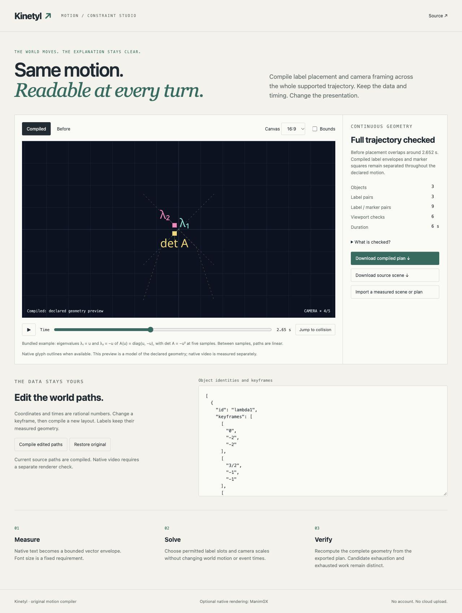

# Kinetyl

**Compile moving diagrams that keep their meaning.**

Labels collide between keyframes. Portrait crops erase important points. Kinetyl solves label placement and camera framing across the entire supported motion, while keeping your world paths, event times and projected label sizes fixed.

[Open the studio](https://nazeeh111.github.io/Kinetyl/) · [Download](https://github.com/nazeeh111/Kinetyl/releases) · [Scene format](SCHEMAS.md)



Actual native exports: [wide MP4](docs/native/wide.mp4) · [portrait MP4](docs/native/portrait.mp4), with [wide](docs/native/wide.json) and [portrait](docs/native/portrait.json) frame receipts.

The example follows the eigenvalues of `A(u) = diag(u, −u)`: two branches cross and the determinant follows five sampled values. Try **Jump to collision**, switch **Before / Compiled**, then change the canvas to **9:16**. The mathematical coordinates stay the same. The determinant is a piecewise linear approximation between its samples, not a continuous quadratic simulation.

## Use it

Python 3.11+. The compiler, verifier and exported browser studio need no runtime dependencies or paid service.

```sh
python -m pip install /path/to/kinetyl-0.1.0-py3-none-any.whl
kinetyl example eigenvalue-crossing --out examples
kinetyl compile examples/eigenvalue-crossing.scene.json --out compiled
kinetyl verify compiled/plan.json
kinetyl export compiled/plan.json --out studio
python -m http.server 8000 --directory studio
```

Open `http://localhost:8000`. Each output command requires a new destination and writes a manifest of file hashes. The export includes an editable plan, measured scene and portable ZIP. Imports are data; no imported code executes. `kinetyl example three-streams --portrait --out streams` provides a second editable case.

For your own text and an actual MP4, install the optional pinned renderer:

```sh
python -m pip install 'kinetyl[render] @ file:///absolute/path/to/kinetyl-0.1.0-py3-none-any.whl'
kinetyl measure examples/eigenvalue-crossing.intent.json --out measured
kinetyl compile measured/scene.json --out planned
kinetyl render planned/plan.json --out video
```

Native rendering uses **ManimGX 0.1.1**, Noto Sans and a supported graphics adapter. It remeasures typography, checks an object-ID pass at every rendered frame, and then exports a normal-color MP4 plus a receipt. Both passes count toward the pixel budget. The receipt distinguishes exact envelope geometry from sampled native pixels, with a four-pixel correspondence tolerance.

## What it solves

Kinetyl uses rational arithmetic to intersect continuous collision intervals on piecewise linear paths. It searches twelve constant label offsets per object, then selects the first feasible declared camera scale and the minimum summed slot cost. An independent verifier recomputes source identity, trajectories, candidate membership, all label pairs, all label–marker pairs and viewport constraints.

The supported model is explicit: 1–8 moving markers, fixed axis-aligned text envelopes, 2–16 keyframes per marker, a shared interval of at most 60 seconds, and a static 2D camera. Font size is a renderer parameter; fixed projected geometry does not guarantee a minimum readable screen pixel size. Rotating or morphing objects, arbitrary callbacks, perspective, custom easing and 3D are outside this format.

**No solution** means no solution in the supplied scale/offset family. **Inconclusive** means the work budget ran out. Imported measurements and receipts are unsigned declarations. Exact rectangles do not certify continuous raster pixels, general accessibility or viewer comprehension.

## Development and provenance

```sh
PYTHONPATH=src python -m unittest discover -s tests
node --test tests/*.test.mjs
```

Kinetyl's compiler, verifier, schemas, CLI and studio are original MIT code, developed with Codex assistance. [ManimGX](https://github.com/academa-labs/manimgx) is an optional renderer by Academa Labs and its contributors, distributed separately under its own licenses. Noto font notices accompany the portable outlines. No upstream benchmark is claimed as a Kinetyl result. See [validation](VALIDATION.md), [contributing](CONTRIBUTING.md) and [security](SECURITY.md).
