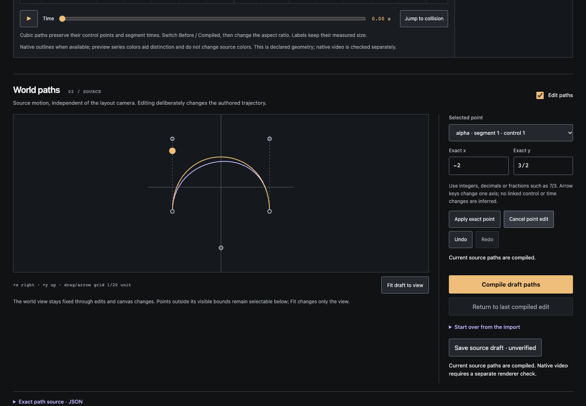

# One authored edit, then a verified layout

This is an executed synthetic example from public main `b5d42527f70ee4016a31f75d1bbd1997daec183d`. No native movie was rendered in this pass. Existing recorded native movies and their receipts remain separate.

In the studio, Alpha's first Bézier control y changed from `2` to `3/2`. This deliberately changes authored motion. Invalid `1/` coordinates were refused without changing source; Cancel restored the field; Undo and Redo reproduced the two exact drafts. The other path rows, including times and envelope data, remained identical. Compile then retained that edited scene while choosing label offsets. Playback advanced; a 9:16 layout was exported and opened in a fresh browser. Malformed JSON retained the previous source document.

The [wide plan](edited-wide.plan.json), [portrait plan](edited-portrait.plan.json) and [wide source scene](edited-wide.scene.json) are actual browser downloads. [Journey](journey.json) and [CLI results](cli.json) retain the concrete checks. Wide and portrait export dimensions differ; paths, controls, timing, label envelopes and measured outlines do not. The camera is static in each plan.

## Read the drawing

[Desktop SVG](motion.svg) · [phone SVG](motion-mobile.svg) · [generator](figure.py) · [hashes and encoding](figure-manifest.json).

The two panels crop the same world-space detail of the edited **wide** plan at **3.00 s**, using identical x/y scale and the same origin. They show Alpha/Beta only; Origin remains in the complete plan. The thin rectangles are the actual declared text envelopes. Filled glyphs are the retained Noto outlines and squares represent marker clearances. Preview colors identify series and do not change source colors. Before uses the actual studio baseline: each label center is above its marker by `envelope.height/2 + radius + margin`, with zero horizontal offset and camera scale 1 in this case. At 3 s, Alpha's label center y is 1.4958946078431372 and Beta's is 1.6327776960784313. The compiler's offsets separate these overlapping envelopes. This is the same edited scene, not a label-on-marker alternative. Both trajectories are actual cubic Béziers; no sampled polyline or invented easing is substituted. The equal screen scales make this a comparison of label placement, not a comparison of wide and portrait camera framing.

This single moment does not establish continuous correctness. Independent verification checks all three label pairs, nine label–marker pairs and six viewport conditions over the complete 0–6 s interval. These are exact declared-envelope constraints, not continuous raster pixels, a physical measurement, a readable-minimum-pixel guarantee or arbitrary animation support.

## Reopen the actual artifact

Download [edited-studio.zip](edited-studio.zip), extract into a new directory and serve that directory with:

```sh
python3 -m http.server 8000 --bind 127.0.0.1
```

Open `http://127.0.0.1:8000`. It contains the actual portrait plan, source scene, verification and all studio scripts/styles plus MIT and Noto notices. `README.txt` explains the route; the external [figure manifest](figure-manifest.json) records every ZIP member hash. Every named member is included. No package installation or renderer is required. A fresh extracted plan was independently verified through the CLI and reopened in Chrome. This local unsigned bundle does not authenticate an origin.

To recreate a studio from the repository, choose a new output directory:

```sh
PYTHONPATH=src python3 -m kinetyl verify docs/presentation/edited-portrait.plan.json
PYTHONPATH=src python3 -m kinetyl export docs/presentation/edited-portrait.plan.json --out edited-studio
```

Existing outputs refuse overwriting. Invalid JSON leaves no new export directory. Optional native measurement/rendering requires the separate pinned ManimGX renderer and compatible graphics environment; it was not installed or tested here. Current source, licenses and upstream notices remain unchanged. Held engineering/feature branches were not merged.

## Actual workspace

<picture>
  <source media="(max-width: 600px)" srcset="studio-mobile.png">
  
</picture>
